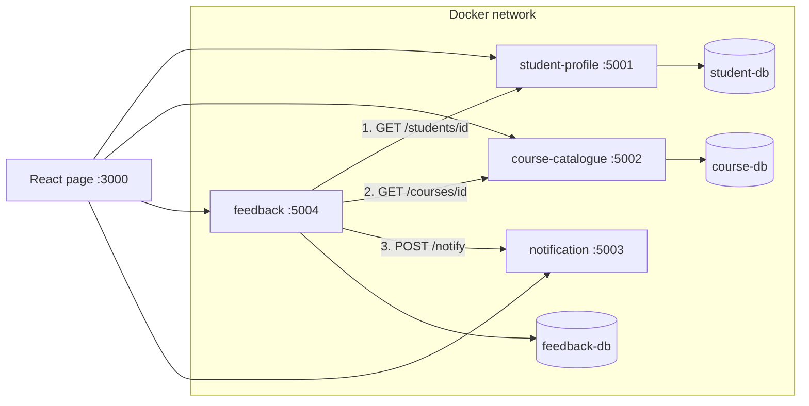

# Student Services Dashboard

This is my INFS605 Assessment 2 project. It is a small student services dashboard built from four Flask services, each running in its own Docker container and started together with Docker Compose. A React page lets you use all of them.


## How it works



Each service has its own database and never reads another service's tables. If a service needs someone else's data, it asks that service's API.

When someone submits feedback, the Feedback service does this:

1. Checks the student exists by calling Student Profile (404 if not).
2. Checks the course exists by calling Course Catalogue (404 if not).
3. Saves the feedback in its own database. It only stores the student and course ids.
4. Calls Notification, which logs a fake email to the student.

If Student Profile or Course Catalogue is down, Feedback returns 503. If only Notification is down, the feedback is still saved and the response says `notification_sent: false`.

## Services

| Service | Port | Database | What it does |
|---|---|---|---|
| student-profile | 5001 | PostgreSQL | Students and their attendance |
| course-catalogue | 5002 | PostgreSQL | List of courses |
| feedback | 5004 | PostgreSQL | Feedback students leave on courses |
| notification | 5003 | None (kept in memory) | Logs mock emails |
| frontend | 3000 | None | React page with a tab for each service |

Built with Docker Compose, Python 3.11 and Flask, PostgreSQL 15, and React (Vite).

## Folder structure

```
[StudentID]-assignment2/
  docker-compose.yml
  .env.example
  .gitignore
  .gitattributes
  README.md
  postgres/init.sql
  student-profile/    app.py, Dockerfile, requirements.txt, wait-for-it.sh
  course-catalogue/   app.py, Dockerfile, requirements.txt, wait-for-it.sh, init.sql
  feedback/           app.py, Dockerfile, requirements.txt, init.sql
  notification/       app.py, Dockerfile, requirements.txt
  frontend/           Dockerfile, package.json, vite.config.js, src/
  screenshots/
  postman/
```

## How to run it

You need Docker Desktop running.

1. Open a terminal in the project folder.
2. Copy `.env.example` to `.env` (`copy .env.example .env` on Windows). The default values work as they are.
3. Run `docker compose up --build`.
4. Check everything is up with `docker compose ps`.
5. Open http://localhost:3000.

The first build can take 5 to 10 minutes because the frontend packages have to download. Later builds are quick.

To stop it, run `docker compose down`. Data is kept in Docker volumes, so it is still there next time. To wipe the data and start again, run `docker compose down -v`.

If port 5432 is already used on your computer, change the left-hand number in the `student-db` ports line. The services talk to each other inside Docker, so nothing else needs changing.

## API endpoints

**student-profile (localhost:5001)**

| Method | Path | What it does |
|---|---|---|
| GET | /students | List students |
| GET | /students/id | Get one student |
| POST | /students | Add a student (name, email) |
| PUT | /students/id | Update a student |
| DELETE | /students/id | Delete a student |
| POST | /students/id/attendance | Record attendance (date, status) |

**course-catalogue (localhost:5002)**

| Method | Path | What it does |
|---|---|---|
| GET | /courses | List courses |
| GET | /courses/id | Get one course |
| POST | /courses | Add a course (code, title, credits) |
| GET | /health | Check the service and its database |

**feedback (localhost:5004)**

| Method | Path | What it does |
|---|---|---|
| GET | /feedback | List feedback, newest first |
| POST | /feedback | Add feedback (student_id, course_id, rating 1 to 5, comment) |
| GET | /health | Check the service and its database |

**notification (localhost:5003)**

| Method | Path | What it does |
|---|---|---|
| POST | /notify | Send a mock email (to, message) |
| GET | /notifications | List the emails sent so far |
| GET | /health | Check the service |

## Logging and errors

Each service writes logs with its own name in every line. To read them, run `docker compose logs <service>`, for example `docker compose logs feedback`.

Errors come back as JSON with a message. The status codes I used are 400 (missing or bad input), 404 (student or course not found), 409 (duplicate course code), 502 (another service sent back an error) and 503 (another service is down).

## Testing

I tested through the React page and with Postman. The Postman collection is in the `postman/` folder, and you can load it with Import in Postman.

| # | What I did | What should happen |
|---|---|---|
| 1 | Opened the Students and Courses tabs | Seed data is shown |
| 2 | Submitted feedback for a real student and course | 201, and it appears in the list |
| 3 | Opened the Notifications tab | A new message for that student's email |
| 4 | Used a course id that does not exist | 404 Course not found |
| 5 | Used a student id that does not exist | 404 Student not found |
| 6 | Left out the comment | 400 |
| 7 | Stopped course-catalogue, then submitted feedback | 503 |
| 8 | Stopped notification, then submitted feedback | Saved, `notification_sent` is false |
| 9 | Added a course with a code that already exists | 409 |
| 10 | Ran `docker compose down` then `up` again | The feedback is still there |

Example:

```
curl -X POST http://localhost:5004/feedback -H "Content-Type: application/json" -d '{"student_id":1,"course_id":1,"rating":5,"comment":"Great course"}'
```

Screenshots of these are in the `screenshots/` folder.

## Problems I ran into

- **A table was missing.** A trailing comma in `init.sql` broke the script, so Postgres started with an empty database. Postgres only runs `init.sql` the first time a volume is created, so I fixed the file and ran `docker compose down -v`.
- **Wrong wait host.** I copied student-profile's Dockerfile for the other services, and it waited for `student-db`. I changed each one to wait for its own database.
- **Port 5432 was taken.** `student-db` would not start, so I changed the host port. Inside Docker it still uses 5432.
- **A confusing SQL error.** A missing space between two joined strings in a query gave me `column "id" does not exist`. I added the space before `FROM`.
- **Wrong port in the frontend.** The feedback form was calling port 5003 (Notification) instead of 5004. The browser showed a CORS error, but the real problem was the port.