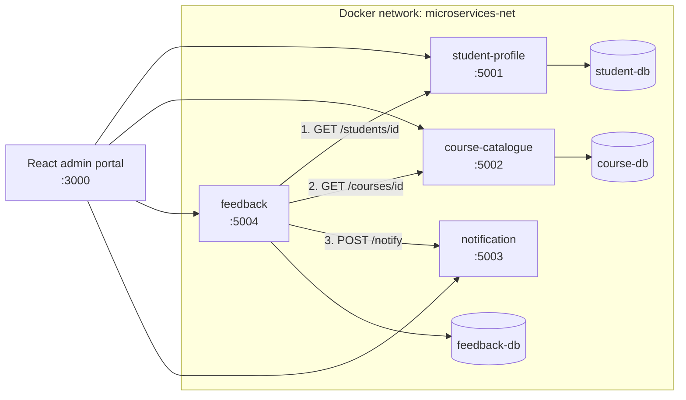

# Student Services Dashboard

A microservices prototype of a student services dashboard for INFS605 Assessment 2. Four small Flask services run in separate Docker containers, each with its own data, and are started together with Docker Compose. A React admin portal ties them together.

**Student:** [Your name], [Your Student ID]
**Course:** INFS605 Microservices, Assessment 2

## Architecture



Each service owns its own database. No service reads another service's tables. The only way to get another service's data is through its API.

### What happens when feedback is submitted

1. The browser sends `POST /feedback` to the Feedback service.
2. Feedback asks Student Profile whether the student exists. If not, it returns 404.
3. Feedback asks Course Catalogue whether the course exists. If not, it returns 404.
4. Feedback saves the record in its own database. It stores only the student and course ids.
5. Feedback calls Notification, which logs a mock email to the student's address.
6. If Student Profile or Course Catalogue cannot be reached, Feedback returns 503. If only Notification is down, the feedback is still saved and the response says `notification_sent: false`.

## Services

| Service | Port | Database | Purpose |
|---|---|---|---|
| student-profile | 5001 | student-db (PostgreSQL) | Student records and attendance |
| course-catalogue | 5002 | course-db (PostgreSQL) | Course list and details |
| feedback | 5004 | feedback-db (PostgreSQL) | Course feedback from students |
| notification | 5003 | none (in memory) | Mock email service that logs messages |
| admin-frontend | 3000 | none | React portal with a tab for each service |

## Technologies

Docker and Docker Compose, Python 3.11 with Flask, PostgreSQL 15, React, Git.

## Directory structure

```
[StudentID]-assignment2/
  docker-compose.yml
  README.md
  .gitignore
  .env.example
  postgres/
    init.sql
  student-profile/
    app.py
    Dockerfile
    requirements.txt
    wait-for-it.sh
  course-catalogue/
    app.py
    Dockerfile
    requirements.txt
    wait-for-it.sh
    init.sql
  feedback/
    app.py
    Dockerfile
    requirements.txt
    init.sql
  notification/
    app.py
    Dockerfile
    requirements.txt
  frontend/
    src/
      App.jsx
      Courses.jsx
      Feedback.jsx
      Notifications.jsx
      index.css
```

## Setup

You need Docker Desktop (or Docker Engine with the Compose plugin). Make sure it is running first.

1. Unzip the project and open a terminal in the project folder.
2. Start everything:
```
   docker compose up --build
```
3. Wait until all containers are running. Check with `docker compose ps`.
4. Open the admin portal at http://localhost:3000.

To stop the system, press Ctrl+C or run `docker compose down`. To reset all databases to their starting data, run `docker compose down -v` and then `docker compose up --build`.

If port 5432 is already in use on your machine, change the left-hand number of the `student-db` ports line in `docker-compose.yml`. Containers talk to each other on the internal port, so nothing else needs to change.

## API endpoints

### student-profile (http://localhost:5001)

| Method | Path | Description |
|---|---|---|
| GET | `/` | Service check message |
| GET | `/students` | List all students |
| GET | `/students/<id>` | Get one student, 404 if missing |
| POST | `/students` | Create a student (`name`, `email`) |
| PUT | `/students/<id>` | Update a student |
| DELETE | `/students/<id>` | Delete a student |
| POST | `/students/<id>/attendance` | Record attendance (`date`, `status`) |

### course-catalogue (http://localhost:5002)

| Method | Path | Description |
|---|---|---|
| GET | `/courses` | List all courses |
| GET | `/courses/<id>` | Get one course, 404 if missing |
| POST | `/courses` | Create a course (`code`, `title`, `credits`) |
| GET | `/health` | Health check, 503 if the database is down |

### feedback (http://localhost:5004)

| Method | Path | Description |
|---|---|---|
| GET | `/feedback` | List all feedback, newest first |
| POST | `/feedback` | Submit feedback (`student_id`, `course_id`, `rating` 1 to 5, `comment`) |
| GET | `/health` | Health check, 503 if the database is down |

### notification (http://localhost:5003)

| Method | Path | Description |
|---|---|---|
| POST | `/notify` | Send a mock email (`to`, `message`), logs it and stores it |
| GET | `/notifications` | List the notifications sent so far |
| GET | `/health` | Health check |

## Logging and error handling

Each service logs to the container output with its own name in the log line. View a service's log with `docker compose logs <service>`, for example `docker compose logs feedback`.

Errors return JSON with a clear message and a suitable status code: 400 for missing or invalid fields, 404 when a student or course does not exist, 409 for a duplicate course code, 502 when another service returns an unexpected error, and 503 when a required service is unreachable.

## Testing

The React portal is the front-end for demonstrating the services. These acceptance tests can be run through it or against the APIs directly.

| # | Test | Expected result |
|---|---|---|
| 1 | Open the Students tab | Seeded students are listed |
| 2 | Open the Courses tab | Seeded courses are shown as cards |
| 3 | Submit feedback for a valid student and course | 201, green success message, record appears in the feedback list |
| 4 | Open the Notifications tab after test 3 | A new message addressed to that student's email |
| 5 | Submit feedback with a course id that does not exist | 404 "Course not found" |
| 6 | Submit feedback with a student id that does not exist | 404 "Student not found" |
| 7 | Submit feedback with a missing field | 400 with the field name |
| 8 | Run `docker compose stop course-catalogue`, then submit feedback | 503 "Course service unavailable" |
| 9 | Run `docker compose stop notification`, then submit feedback | Feedback saved, `notification_sent` is false |
| 10 | Add a course with a code that already exists | 409 "Course code already exists" |

Example request:

```
curl -X POST http://localhost:5004/feedback \
  -H "Content-Type: application/json" \
  -d '{"student_id":1,"course_id":1,"rating":5,"comment":"Great course"}'
```

## Screenshots

Screenshots are in the `screenshots/` folder.

- [ ] `docker compose ps` with all containers running
- [ ] Each portal tab (Students, Courses, Feedback, Notifications)
- [ ] A feedback submission and the matching notification
- [ ] The 503 error case with Course Catalogue stopped
- [ ] Logs showing a saved feedback record

## Development issues and fixes

- **Database table was never created.** A trailing comma in `init.sql` caused a syntax error, so Postgres skipped the file and left an empty database. PostgreSQL only runs `init.sql` on a new data volume, so the fix was to correct the file and run `docker compose down -v`.
- **Copied services waited for the wrong database.** The Dockerfile copied from student-profile waited for `student-db`. Course Catalogue now waits for `course-db`, and Notification and Feedback no longer wait for a database they do not use.
- **Port already in use.** Port 5432 was taken on the host machine, so `student-db` failed to start. The host port was changed. Containers still use 5432 on the internal network.
- **Misleading SQL error.** A missing space between two joined query strings produced `column "id" does not exist`. The fix was to add the space before `FROM`.
- **Frontend called the wrong service.** The Feedback form used port 5003 (Notification) instead of 5004. The browser reported this as a CORS error, but the real cause was the wrong port.
- **Services must use service names, not localhost.** Inside Docker, Feedback reaches other services at addresses like `http://student-profile:5001`.

## Known limitations

- Notifications are held in memory and are cleared when the Notification container restarts.
- Credentials are set directly in `docker-compose.yml` for this prototype. A production system would use secrets.
- The Flask development server is used. A production setup would use a WSGI server such as gunicorn.
- There is no authentication.
